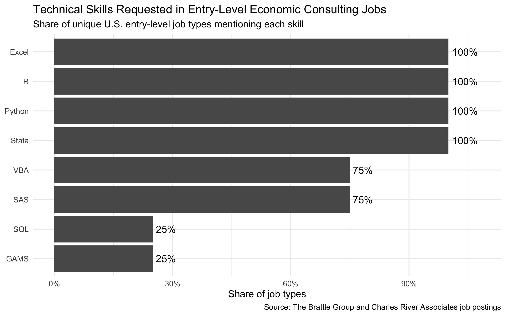
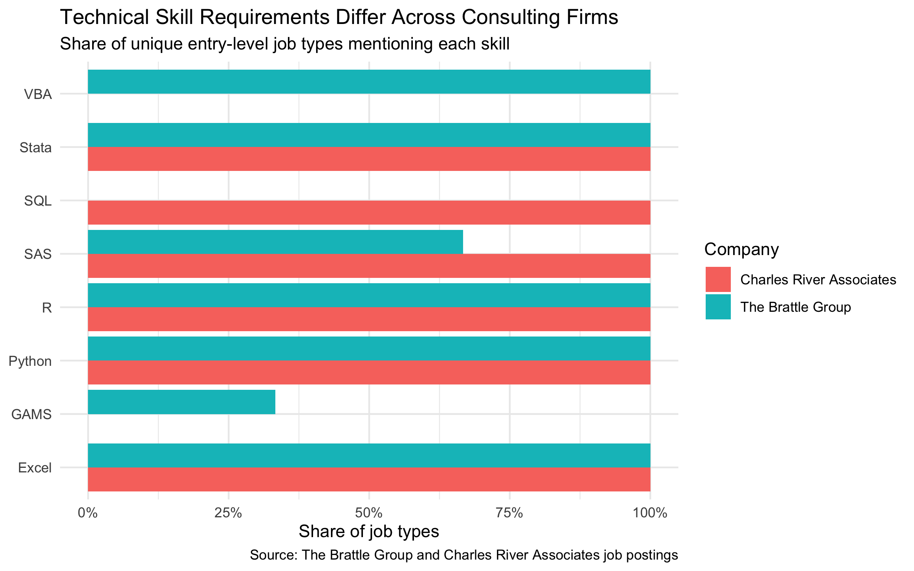

## Introduction

Students targeting entry-level economic consulting roles are often told to learn a wide range of technical tools: Excel, R, Python, Stata, SQL, SAS, and sometimes more specialized software. But when recruiting season is approaching and preparation time is limited, which skills appear most consistently in the entry-level positions offered by the firms they may actually target?

To investigate this question, I examined a selected sample of current entry-level job postings from two economic consulting firms, **The Brattle Group** and **Charles River Associates (CRA)**. Rather than treating the results as a general ranking of skills for all students, I use these postings to identify which technical tools appear consistently in this specific sample and which seem more firm-specific.

## Collecting the Data


I used the `rvest` package in R to collect publicly available job postings from
[The Brattle Group's Greenhouse job board](https://job-boards.greenhouse.io/thebrattlegroup)
and
[Charles River Associates' Greenhouse job board](https://job-boards.greenhouse.io/charlesriverassociates).
I only accessed pages that were publicly visible and did not attempt to bypass logins, CAPTCHAs, or other access restrictions.

For Brattle, I scraped the firm's Greenhouse job-board page to collect individual
job URLs and then visited each posting. The analysis script later filters these
postings to selected entry-level analyst and internship roles. For CRA, I manually
selected two publicly available entry-level economics consulting postings from the
firm's Greenhouse site and scraped those individual pages.

```{r}
#| eval: false

library(rvest)
library(dplyr)
library(purrr)

scrape_brattle_job <- function(url) {

  Sys.sleep(1)

  page <- read_html(url)

  tibble(
    job_title = page |> html_element("h1") |> html_text2(),
    job_url = url,
    job_description = page |> html_element("body") |> html_text2()
  )
}
```

I then restricted the Brattle sample to selected entry-level analyst and internship positions. Because the same Brattle position was sometimes posted separately for multiple cities, I removed duplicate job titles so that one job description would not receive more weight simply because it was offered in several locations.

The final sample contained **eight unique entry-level job types**: six from Brattle and two from CRA.

## Which Skills Appear Most Often?

I searched each job description for eight technical skills: **Excel, R, Python, Stata, SQL, SAS, VBA, and GAMS**. Each skill was coded as either present or absent in a posting.

{width="800"}

The first result is striking. **Excel, R, Python, and Stata appeared in all eight job types in the sample.** SAS and VBA appeared in six of the eight, while SQL and GAMS appeared in only two.

Within this sample, the most common pattern is not a choice between R and Python: the postings frequently mention both, alongside Stata and Excel. For students specifically targeting entry-level economic consulting roles at firms like Brattle and CRA, these four tools therefore appear to be a useful starting point for further preparation.

## Do Firms Ask for the Same Skills?

The overall percentages hide an important difference between firms.

{width="800"}

Both Brattle and CRA consistently mentioned **Excel, R, Python, and Stata**, suggesting that these four tools form a common technical core in this sample.

The more specialized skills differed substantially. All six Brattle job types mentioned VBA, while neither CRA posting did. GAMS appeared in some Brattle roles but neither CRA role. In contrast, both CRA job types mentioned SQL, while none of the six Brattle job types did. SAS appeared in both firms, although more consistently at CRA.

This distinction matters because a simple industry-wide ranking can hide differences in how individual firms work.

## What Does This Sample Suggest for Preparation?

Based on these eight job types, I would divide preparation into two stages.

First, focus on **Excel, R, Python, and Stata** when preparing for similar entry-level roles. They were the only four skills mentioned across every job type in this sample, making them the clearest common pattern in the postings examined here.

Second, tailor additional preparation to the firms being targeted. For example, VBA and GAMS may be especially relevant to some Brattle roles, while SQL appears more relevant in the CRA postings examined here.

There are important limitations. This is a small sample of eight unique job types from only two firms, and job postings change over time. The results therefore describe these postings rather than the entire economic consulting industry. They also should not be interpreted as evidence that these are the most useful skills for every student or for every type of job.

## Takeaway

Web scraping turns scattered job descriptions into structured information that can support a practical decision. In this sample, the clearest pattern is a shared core of **Excel, R, Python, and Stata**, followed by more firm-specific tools such as SAS, VBA, SQL, and GAMS.

For students targeting entry-level economic consulting roles similar to those in this sample, the postings suggest starting with the common core and then using current openings at specific target firms to decide which additional tools may be worth learning. This is a practical reading of these postings, not a general ranking of the skills all students should prioritize.