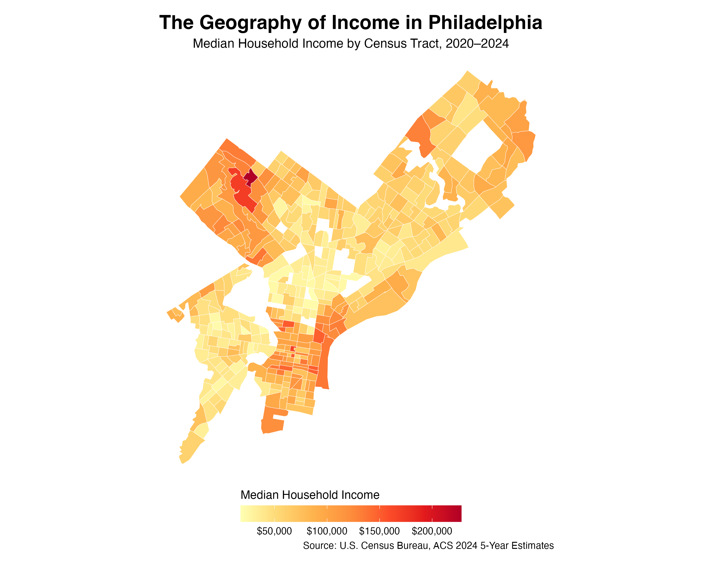

---
title: "The Geography of Income in Philadelphia"
subtitle: "Exploring Spatial Inequality Using Census Data"
author: "Xunyao Xu"
date: 2026-10-19
categories: [GIS, Economics, Philadelphia]
format: html
toc: true
---

## Introduction

Income inequality is not only about differences between individuals. It also has an important geographic dimension. Within the same city, households in different neighborhoods may experience very different economic conditions.

In this post, I explore the geographic distribution of median household income across Philadelphia using data from the U.S. Census Bureau's American Community Survey (ACS). By mapping income at the census tract level, I examine where higher- and lower-income areas are concentrated and what these patterns suggest about spatial inequality.

## Data and Methods

This analysis uses data from the U.S. Census Bureau's 2024 American Community Survey (ACS) 5-Year Estimates, covering the period from 2020 to 2024. The data were obtained using the `tidycensus` package in R.

The main variable is median household income (`B19013_001`), measured in 2024 inflation-adjusted dollars. I focus on census tracts within Philadelphia County, Pennsylvania. Census tracts are relatively small geographic areas that allow us to examine income differences within the city.

To prepare the data, I removed census tracts with missing or invalid income estimates. I then combined the income information with geographic boundaries provided by the Census Bureau.

For visualization, I used the `sf` and `ggplot2` packages to create a choropleth map. Each census tract is shaded according to its median household income, with lighter yellow representing lower incomes and darker red representing higher incomes.

Because ACS figures are survey estimates, they are subject to sampling uncertainty. Furthermore, census tract boundaries do not necessarily correspond to commonly recognized neighborhood boundaries.

## Mapping Household Income

The map below illustrates the geographic distribution of median household income across Philadelphia's census tracts.

{#fig-income width="95%"}

The map reveals substantial geographic variation in household income across Philadelphia. Higher-income census tracts appear in several clusters, particularly in parts of northwestern Philadelphia. Meanwhile, many other areas have considerably lower median household incomes.

These differences suggest that income inequality in Philadelphia has a strong spatial dimension. Rather than being evenly distributed throughout the city, higher- and lower-income households appear to be concentrated in particular geographic areas.

However, the map represents median household income at the census tract level, not the income of individual residents. It also does not establish why these geographic differences exist.

## Discussion

The income data reveal substantial economic differences across Philadelphia's 375 census tracts. The median of tract-level median household incomes is approximately $62,083, while the average is $68,707. The 25th percentile is $43,529, compared with $88,647 at the 75th percentile. This means that the median household income in a tract at the 75th percentile is approximately twice that of a tract at the 25th percentile.

The differences become even more pronounced when comparing the extremes. The lowest observed tract median household income is $17,875, while the highest is $227,656. Although these extreme values may not represent typical neighborhoods, they illustrate the wide variation in local economic conditions within Philadelphia.

The map adds an important geographic perspective to these statistics. Higher-income areas appear concentrated in certain parts of the city, including portions of northwestern Philadelphia, while lower-income tracts are distributed across many other areas. These patterns suggest that income differences are not randomly scattered across the city.

Several factors could contribute to these geographic differences, including housing costs, historical development, access to employment opportunities, and residential sorting. However, this descriptive analysis cannot establish which factors cause the observed patterns.

It is also important to recognize that census tract median income does not represent every household within a tract. Furthermore, the statistics summarize tracts rather than individual households, and ACS estimates are subject to sampling uncertainty.

## Conclusion

This analysis highlights the geographic dimension of income inequality in Philadelphia. Using ACS data and GIS visualization, I find substantial differences in median household income across the city's census tracts.

The comparison between the 25th and 75th percentiles suggests that income differences are not limited to a few extreme observations. The map further illustrates how these differences vary across geographic areas.

The main takeaway is that understanding urban economic inequality requires attention not only to income levels but also to where households live. Geographic visualization provides a useful starting point for identifying patterns that may motivate further research into housing affordability, neighborhood development, and economic opportunity.
