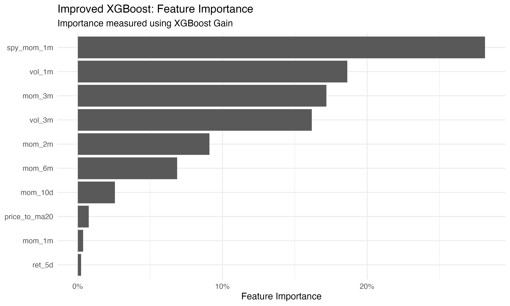
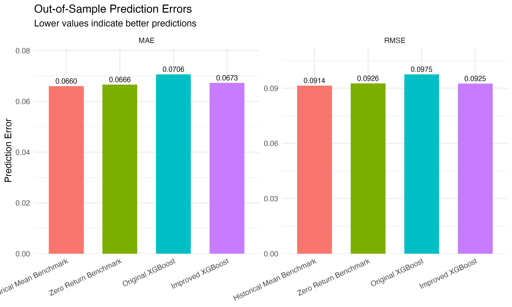
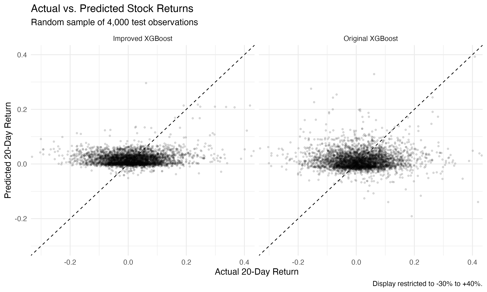
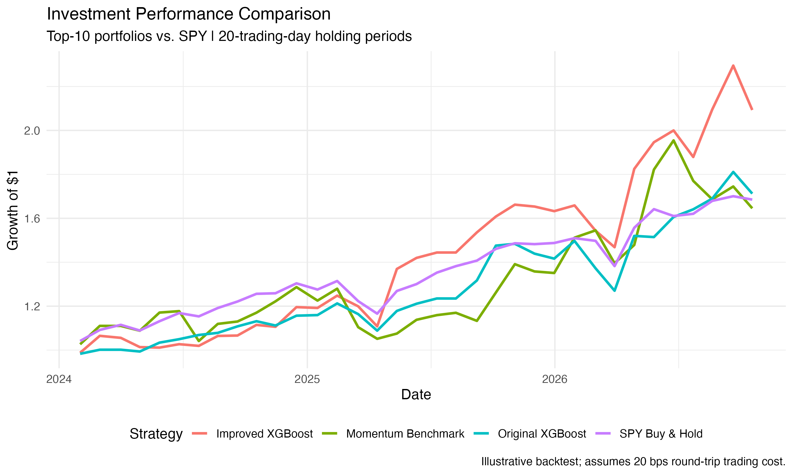
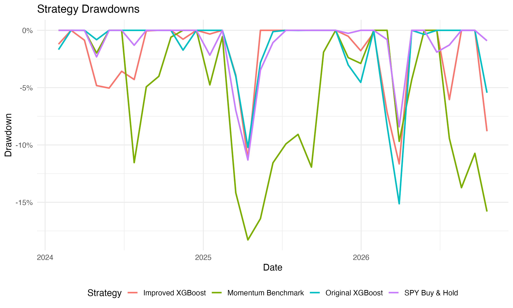

## Introduction

Can machine learning predict which stocks will perform well? This is an appealing question for investors and an unusually difficult one for forecasters. Stock prices incorporate information quickly, expected returns can change with market conditions, and relationships that appear strong in historical data may disappear out of sample. Flexible machine-learning algorithms can uncover nonlinear patterns, but they can also overfit noise.

This post revisits a classroom experiment using **extreme gradient boosting (XGBoost)** to predict future equity returns. I first reproduce a baseline model based on the original classroom configuration and then build an improved version with additional price-based features and hyperparameter selection. I compare both models with simple forecasting benchmarks on observations from **2024 onward**. Finally, I translate their forecasts into hypothetical top-10 stock portfolios and compare their performance with momentum investing and a passive investment in SPY.

The central finding is nuanced: **the improved model reduces forecast error relative to the original XGBoost, but neither model beats a historical-mean forecast by RMSE. Nevertheless, the improved model performs best in this particular historical top-10 portfolio backtest.** Prediction accuracy and investment usefulness are not the same thing.

## 1. Revisiting the original experiment

The classroom project starts with historical daily stock prices and constructs signals commonly used in quantitative finance. A gradient-boosted decision-tree model estimates the future return of each stock. The stocks with the highest predicted returns are selected for an equally weighted portfolio.

The experiment's XGBoost settings were:

| Parameter | Classroom baseline setting |
|:--|--:|
| Trees | 300 |
| Maximum tree depth | 5 |
| Learning rate | 0.05 |
| Minimum node size (`min_n`) | 10 |
| Prediction horizon | Approximately 20 trading days |

The initial signals include one-, three-, and six-month momentum, a recent five-day return, trailing volatility, and market-adjusted daily returns. The general intuition is that patterns in recent returns and risk might help predict subsequent performance. But tree-based models can fit idiosyncratic historical movements that do not repeat in the future.

**Replication note.** My *Original XGBoost* follows the classroom model's core configuration, but uses consistently defined historical features, an explicitly aligned target, and a leakage-aware training cutoff. It is therefore a controlled replication rather than a byte-for-byte execution of the instructor's original script.

## 2. Data and research design

The dataset contains adjusted daily prices for **95 U.S. stocks**, collected programmatically with the R package `tidyquant`, together with **SPY** as a market benchmark. Prices were downloaded for January 2022 through **November 13, 2026**. After constructing rolling features and future returns, the usable prediction dataset contains **102,125 stock-day observations**, beginning on July 6, 2022. The aligned out-of-sample comparison contains **66,500 observations**.

For each stock observed at the close on date $t$, I define the prediction target as the subsequent 20-trading-day close-to-close return, beginning at the *next* closing price:

$$
y_{i,t}=\frac{P^{\mathrm{adj}}_{i,t+21}}{P^{\mathrm{adj}}_{i,t+1}}-1.
$$

This convention permits the model to use information available at the end of date $t$ and avoids pretending that the portfolio could be traded at the very same closing price used to generate the signal. The variable `target_end_date` identifies when the future outcome becomes observable.

The final XGBoost models use returns whose outcome dates fall before **January 1, 2024**, while the untouched evaluation period begins in 2024. For improvement-model selection, I train on an earlier subset and evaluate candidate parameters using a separate 2023 validation period. Importantly, observations whose outcome window crosses a training or validation boundary are excluded from the earlier period.

### Forecasts being compared

| Method | Description |
|:--|:--|
| Historical mean | Predict the average target return observed in the eligible pre-2024 training data. |
| Zero return | Always predict a return of zero. |
| Original XGBoost | Six technical predictors and the classroom-style hyperparameters. |
| Improved XGBoost | Eleven technical predictors; hyperparameters chosen using pre-test validation. |

All reported prediction metrics use **the same set of stock-date observations**, so they can be compared directly.

## 3. Improving the XGBoost model

I make two substantive changes. First, I expand the feature set from six to eleven predictors. In addition to the original momentum, volatility, and excess-return measures, I add **10-day momentum**, **two-month momentum**, **three-month volatility**, **price relative to its 20-day moving average**, and **SPY one-month momentum**. These variables provide a broader description of short-term trends, medium-term risk, and the overall market environment.

Second, rather than relying exclusively on the original 300-tree, depth-five specification, I evaluate four candidate hyperparameter combinations on the validation sample. The selected configuration has **150 trees**, a **maximum depth of two**, a **learning rate of 0.03**, and **minimum node size of 20**. The shallower model reduces flexibility, which can be desirable when financial returns have a low signal-to-noise ratio.

The model is then refitted on all eligible pre-2024 training observations, and the test period is evaluated only after model selection. The goal is not to search the test data for the best-performing specification.

{#fig-feature-importance width="100%"}

Figure @fig-feature-importance summarizes the fitted model's feature importance using XGBoost *Gain*. Importance identifies variables the model relied on; it does **not** establish that any indicator causes future stock returns.

## 4. Out-of-sample predictive performance

The next table reads the results saved by the reproducible R analysis. For RMSE and MAE, **lower is better**; for $R^2$, **higher is better**.

```{r}
#| label: tbl-forecast-results
#| tbl-cap: "Prediction performance on the common out-of-sample stock-date panel"
forecast <- read.csv("data/model_comparison.csv", stringsAsFactors = FALSE)
forecast_table <- data.frame(
  Model = forecast$Model,
  N = format(forecast$N, big.mark = ",", trim = TRUE),
  RMSE = sprintf("%.4f", forecast$RMSE),
  MAE = sprintf("%.4f", forecast$MAE),
  `Out-of-sample R2` = sprintf("%.4f", forecast$OOS_R2),
  `Direction accuracy` = ifelse(
    is.na(forecast$Direction_Accuracy),
    "N/A", sprintf("%.2f%%", 100 * forecast$Direction_Accuracy)
  ),
  check.names = FALSE
)
knitr::kable(forecast_table, align = c("l", "r", "r", "r", "r", "r"))
```

{#fig-prediction-errors width="100%"}

The improved model's **RMSE falls from 0.0975 to 0.0925**, a relative reduction of approximately **5.18%**. Its MAE falls from 0.0706 to 0.0673, and its conventional test-period $R^2$ improves from **-0.1390 to -0.0244**. Thus, the modification is a meaningful improvement over the original model.

However, the **historical-mean benchmark has an RMSE of 0.0914**, slightly lower than that of the improved XGBoost. The improved model's $R^2$ relative to that historical-mean forecast is **-0.0242**: even this more sophisticated model does not outperform a simple forecast in squared-error terms. This distinction matters more than an isolated comparison between two machine-learning specifications.

{#fig-actual-predicted width="100%"}

Figure @fig-actual-predicted illustrates how dispersed future stock returns are relative to the model forecasts. The models' predictions tend to occupy a narrower range than the realized outcomes, which is consistent with noisy targets and limited forecastability.

### Does the model predict the direction of returns?

The original and improved XGBoost achieve direction accuracies of **50.91%** and **53.82%**, respectively. Yet **56.11%** of stock-date targets are positive in the test sample, so a naive rule that *always predicts a positive return* performs better on this particular accuracy measure. A majority-up market can make directional accuracy misleading. It is therefore important to consider forecast errors and the potential value of ranking stocks, not direction accuracy alone.

## 5. Does the improvement have investment value?

To test economic usefulness, I construct a hypothetical long-only portfolio by ranking stocks according to each XGBoost model's predicted future return and selecting the **top 10**. Stocks receive equal weights. The portfolio is rebalanced every **20 trading days**, with each signal based on the information available at the signal date close. The assumed entry and exit prices are the next trading day's close and the close 20 trading days after entry.

For comparison, I also simulate a simple **six-month momentum** top-10 strategy and **SPY buy-and-hold**. Model portfolios are charged an assumed **20-basis-point cost per round trip**, while the passive SPY benchmark is charged that cost once at the initial investment. These are illustrative assumptions; this is not an executable trading recommendation.

```{r}
#| label: tbl-backtest-results
#| tbl-cap: "Illustrative 20-trading-day portfolio backtest: 35 holding periods"
backtest <- read.csv("data/backtest_performance.csv", stringsAsFactors = FALSE)
backtest_table <- data.frame(
  Strategy = backtest$model,
  Periods = backtest$periods,
  `Final value of $1` = sprintf("$%.2f", backtest$final_value),
  `Annualized return` = sprintf("%.1f%%", 100 * backtest$annualized_return),
  `Sharpe (rf = 0)` = sprintf("%.2f", backtest$sharpe),
  `Max observed drawdown` = sprintf("%.1f%%", 100 * backtest$max_drawdown),
  check.names = FALSE
)
knitr::kable(backtest_table, align = c("l", "r", "r", "r", "r", "r"))
```

{#fig-cumulative-returns width="100%"}

Over the **35 reported holding periods**, the improved XGBoost portfolio grows a hypothetical **$1 to $2.09**, compared with **$1.71** for the original XGBoost and **$1.69** for SPY. Its reported annualized return is **30.5%**, versus **21.4%** for the original model and **20.7%** for SPY. The improved model thus produces the highest observed cumulative performance in this historical exercise.

However, return alone is not sufficient. The improved XGBoost has a **Sharpe ratio of 1.16**, while **SPY's Sharpe is 1.44** under the analysis's zero-risk-free-rate convention. The passive benchmark delivers less overall return but greater return relative to the volatility of these sampled holding-period observations.

{#fig-drawdowns width="100%"}

The sampled maximum drawdown is approximately **-11.6%** for improved XGBoost and **-11.3%** for SPY; the original XGBoost records **-15.1%**. These are *holding-period-end* drawdowns, not true intraperiod maximum drawdowns. A portfolio could experience deeper declines between the recorded observations.

## 6. Interpretation and limitations

This experiment highlights a distinction between **forecasting a precise return** and **ranking stocks for investment**. A model may have weak squared-error performance while still assigning relatively attractive rankings to some securities. Conversely, improvements in RMSE do not guarantee improvements in Sharpe ratio or net returns. In these results, the improved model beats the original XGBoost on forecasting error and historical portfolio performance, but it does **not** beat the simple historical-mean forecast on RMSE or passive SPY on Sharpe ratio.

There are important reasons not to overinterpret the backtest:

- **Survivorship and universe selection:** The stock universe is a fixed group of large U.S. companies selected using a current list, not a point-in-time reconstruction of historical index membership; delisted firms may be absent.
- **Transaction and implementation costs:** The 20-basis-point cost assumption does not model individual trade turnover, market impact, actual bid-ask spreads, taxes, or liquidity restrictions.
- **Portfolio construction and timing:** Signals use closing information and positions are evaluated on a 20-trading-day schedule; intraperiod risk and execution conditions are simplified.
- **Single historical evaluation window:** Patterns may not survive different economic regimes. The reported results are exploratory and were examined during model development, so further untouched-period validation would be needed before any claim of robustness.
- **Sampling dependence:** Daily stock-date observations and overlapping forward returns are correlated, making simplistic inference based on their raw count inappropriate.

A stronger extension would use a point-in-time stock universe, realistic turnover-based trading costs, rolling or expanding-window retraining, and multiple forward-testing periods. These are not needed to see the main lesson: a favorable backtest is not the same as a reliable trading edge.

## Conclusion

The improved gradient-boosting model provides a concrete example of how additional features and more conservative hyperparameters can improve a stock-return forecasting experiment. Compared with the original XGBoost, it lowers test RMSE by **about 5.18%**, but still does not beat the simple historical-mean forecast. Its direction accuracy of **53.82%** also trails the **56.11%** always-up benchmark.

The economic results tell a different story: the improved model's hypothetical top-10 portfolio earns the highest cumulative return in this test, while passive SPY provides the highest Sharpe ratio. **The takeaway is not that machine learning has solved stock-market prediction. It is that predictive accuracy, ranking usefulness, risk, and implementation costs are distinct dimensions that must all be evaluated out of sample.**

## Data, code, and reproducibility

The analysis uses programmatically obtained adjusted stock-price data through **`tidyquant`**, with SPY as the market comparator. All model fits, saved predictions, evaluation metrics, and figures are produced by the accompanying R scripts. The relevant analysis files are `01_data_preparation.R` through `07_visualizations.R`, and the output tables are stored under `data/`. See this post's `README.md` for replication steps.
